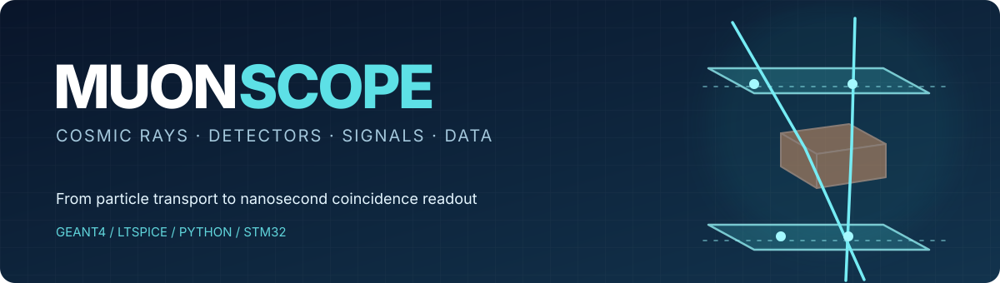
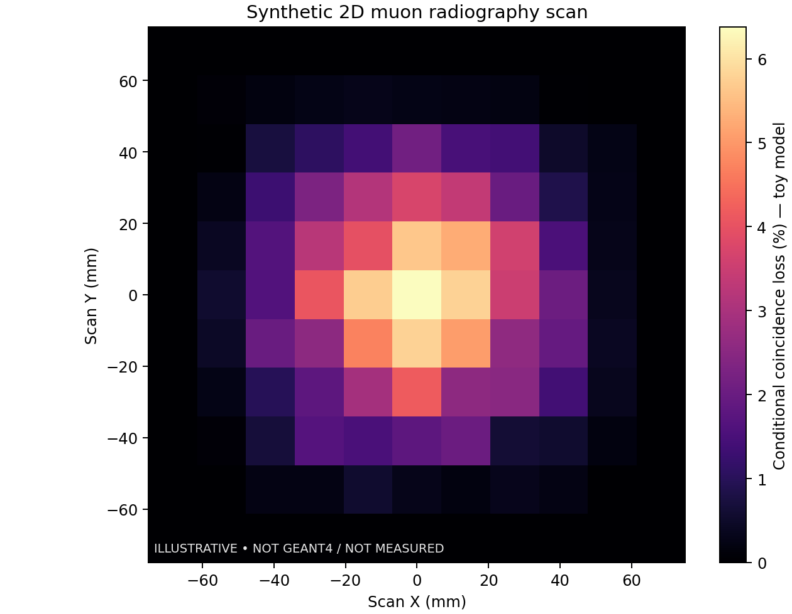
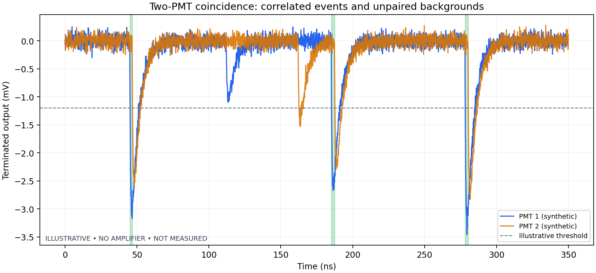
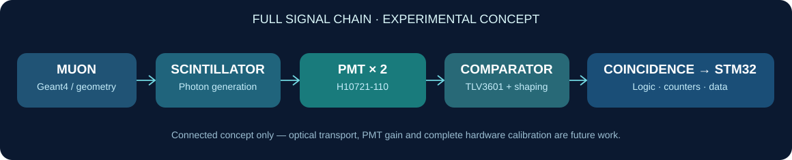
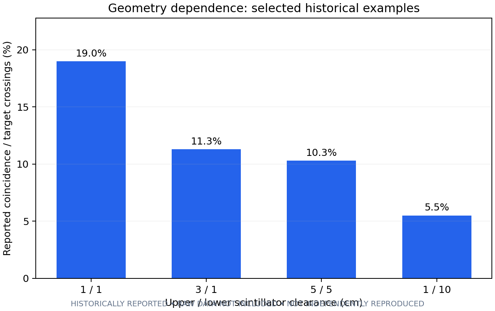
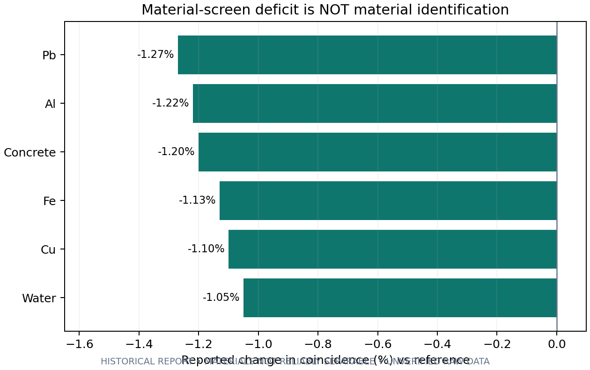

<!-- MUONSCOPE-TEAM-BEGIN -->
### Project team

[Burhan Karaduman](www.linkedin.com/in/burhan-karaduman-57b348362)** , **[Ergün Özakyıldız](https://tr.linkedin.com/in/erg%C3%BCn-%C3%B6zaky%C4%B1ld%C4%B1z-822a24188/)** , **[Nazlıcan Yıldırım](https://www.linkedin.com/in/nazlicanyildirim255/)** , **[Emre Yağız Öztürk](https://www.linkedin.com/in/emre-ya%C4%9F%C4%B1z-%C3%B6zt%C3%BCrk-22037a295/?lipi=urn%3Ali%3Apage%3Ad_flagship3_profile_view_base%3BvSzvEMe4QaaLaLbIvS64Vw%3D%3D)**

<sub>Emre's direct profile URL has not yet been verified. Replace the search link when available.</sub>
<!-- MUONSCOPE-TEAM-END -->

---
<div align="center">



# MuonScope
### A research-grade workspace for cosmic-muon radiography, simulation and fast detector readout

**Geant4 · Scintillators · Hamamatsu PMT · TLV3601 · LTspice · Python · Coincidence counting**

[](.github/workflows/ci.yml)
[](simulation/geant4/)
[](docs/validation-and-limitations.md)
[](LICENSE)
[](pyproject.toml)

*Reproducible code. Traceable assumptions. Clear separation between simulation and measurement.*

</div>

> [!IMPORTANT]
> **Scientific status:** This repository contains validated **Python toy-model tests**, a newly authored **Geant4 example that still requires compilation/validation**, original LTspice **schematics supplied in the project archives**, and a **historical record** of large 2026 Geant4 campaigns. The original production Geant4 data and scripts were *not* provided in this conversation and therefore are **not represented as included or independently re-run**. No hardware measurement or 3D tomography is claimed.

## Why this project?

Cosmic muons penetrate dense matter. By comparing detector-coincidence rates with and without an object, a simple dual-panel detector can explore spatially varying transmission. MuonScope connects the full engineering chain: **particle transport → scintillator interaction → PMT current → comparator/discriminator → coincidence logic → counting → statistically defensible analysis**.

<table>
<tr><td width="50%"></td><td width="50%"></td></tr>
<tr><td><sub>Illustrative two-dimensional scan, <strong>toy surrogate—not Geant4 or measured data</strong>.</sub></td><td><sub>Synthetic negative PMT pulses; correlated events, noise and a simple coincidence matcher.</sub></td></tr>
</table>

### System in one glance



## What's inside

| Workstream | Included | Status / scope |
|:---|:---|:---|
| Geant4 transport | [C++17 + CMake example](simulation/geant4/) | **Not compiled here**; FTFP_BERT, two scintillators, optional Pb cube, event-level energy deposition |
| Large simulation campaigns | [Historical campaign log](docs/results/2026-campaigns.md) | 444-run scan and 550-run focus study **reported**, raw outputs absent |
| Geometry optimization | [Paired gap-scanning workflow](simulation/workflows/run_pair_scan.py) | Resumable orchestration for the new Geant4 example; not the historical engine |
| Muon radiography | [Python model](src/muonscope/physics.py) | Tested, seeded, explicit *toy* transmission; Wilson binomial intervals |
| PMT modeling | [Waveform generator](src/muonscope/electronics.py) | Tested double-exponential negative pulse model + noise |
| Fast analog electronics | [TLV3601 LTspice schematic](hardware/ltspice/tlv3601/) | Source schematic supplied; vendor models omitted for licensing |
| Comparator alternative | [LM358 schematics](hardware/ltspice/lm358/) | Educational *negative* comparison; **not suitable for ns pulses** |
| Historical PMT stimuli | [Three LTspice cases](hardware/ltspice/realistic-pmt/) | Supplied waveforms, **uncalibrated and potentially outside PMT ratings** |
| PCB development | [KiCad Rev AB candidate schematic](hardware/pcb/MUON_RevAB_TAM_CIZILMIS_PROTOTIP.kicad_sch) | Historical engineering schematic; ERC/board fabrication not validated |
| Hardware procurement | [BOM](hardware/bom/) | Preliminary, footprints/power design must be verified |
| Automated quality | [Tests + GitHub Actions](tests/) | Python tests and repeatable small CI demo |

## Quick start — Python (works without Geant4 or LTspice)

```bash
git clone https://github.com/BurhanKARADUMAN/muonscope-research.git
cd muonscope-research
python -m venv .venv
# Windows PowerShell: .venv\Scripts\Activate.ps1
# Linux/macOS: source .venv/bin/activate
python -m pip install -e ".[dev]"
pytest -q
python -m muonscope demo --output-dir outputs/demo --seed 2026
python -m muonscope simulate --primaries 100000 --upper-gap-mm 50 --lower-gap-mm 100
python -m muonscope pulses --output outputs/demo/pmt_waveforms.png
```

Generated demo files are CSV (`scan_counts.csv`), JSON (`summary.json`) and PNGs. Committed example figures under [`examples/demo`](examples/demo/) were produced with a documented seed. Defaults are **illustrative, not tuned to 2026 Geant4 or experimental data**.

**Geant4 instructions:** [simulation/geant4/README.md](simulation/geant4/README.md)  
**LTspice instructions:** [hardware/ltspice/README.md](hardware/ltspice/README.md)

## A key electronics finding: the analog front end must be calibrated

The intended PMT module is the **Hamamatsu H10721-110 (current-output type)**. Its manufacturer lists a **maximum output signal current of 100 µA** and a typical **0.57 ns rise time**. A naive 50 Ω load yields `V = IR = 5 mV` at 100 µA, *before* considering bandwidth, impedance matching and actual event statistics. The historical **−220 mV / −145 mV** stimulus across a 49.9 Ω terminator therefore **cannot be presented as an unamplified, rated H10721-110 output**. Those archived signals are stress-test inputs, not experimentally validated PMT waveforms. [Read the audit](docs/pmt-and-signal-integrity.md).

**TLV3601** is the intended nanosecond-class comparator (TI quotes 2.5 ns typical propagation delay under specified conditions), while the **LM358** is an operational amplifier whose bandwidth/slew-rate are unsuitable for direct 8–15 ns discrimination. Comparator inputs, thresholds, biasing and analog gain cannot be set from a Geant4 photoelectron threshold without measured calibration.

## Historical simulation snapshot (reported; not newly reproduced)

| Study | Reported extent | Main takeaway |
|:---|:---|:---|
| Geometry/night scan (28 Oct 2026) | **444 runs**, **24,800,040 primary muons** | Detector clearances strongly change geometric acceptance and coincidence efficiency |
| Focused study (3 Nov 2026) | **550/550 runs**, **1,251,006,000 primaries**, **275 empty/sample pairs** | Repeatable scan-pattern signal, *not* validated material identification |
| Independent spatial validation | 25 scan positions; reported discovery-to-holdout **r = 0.941** and **24/25 matching signs** | Encouraging spatial repeatability with mechanical scanning |
| Regional holdout | Reported central-vs-outer contrast **|Z| = 5.08** | A *predefined regional comparison*; not per-muon imaging |
| Material/void comparisons | Pb/Fe/Al/Cu/concrete/water and voids | **Not reliably separable** in the reported configuration |

These values are **historical summaries** of prior work. They are not produced by the repository's toy example or the new Geant4 demo. See [full detailed run ledger and limitations](docs/results/2026-campaigns.md).

<table>
<tr><td width="50%"></td><td width="50%"></td></tr>
<tr><td><sub>Selected historical gap configurations: **reported, not independently verified**.</sub></td><td><sub>Similar material losses do **not** establish material discrimination.</sub></td></tr>
</table>

## Be precise about “tomography”

Two non-position-resolving scintillators can provide coincidence **counting/radiography** with mechanical scanning. They do **not** provide the incoming and outgoing track vectors required by point-of-closest-approach (PoCA) muon scattering tomography. Full 3D scattering reconstruction generally requires **multiple position-sensitive tracking planes**, precise alignment and track-fitting. See [measurement model](docs/methodology.md).

## Documentation

- [Research architecture and detector stack](docs/detector-system.md)
- [Muon transport and statistical methodology](docs/methodology.md)
- [Simulation campaigns, numerical findings and provenance](docs/results/2026-campaigns.md)
- [PMT realism and signal-integrity audit](docs/pmt-and-signal-integrity.md)
- [TLV3601, LM358 and coincidence front-end](docs/electronics.md)
- [Calibration plan and test protocol](docs/calibration-protocol.md)
- [Validation boundaries and open research questions](docs/validation-and-limitations.md)
- [Hardware bill of materials](hardware/bom/README.md)
- [Archived LTspice source and original asset SHA256 manifest](hardware/ltspice/ASSET_MANIFEST.csv)
- [Reproduction and data policy](docs/reproducibility.md)
- [Safe instructions for publishing a **new** GitHub repository](docs/github-publishing.md)
- [References](docs/references.md)

## Roadmap

- [x] Consolidate dual-channel TLV3601/LM358 LTspice designs and recorded synthetic PMT stimuli
- [x] Provide tested Python radiography/pulse illustrations with automated CI
- [x] Document reported Geant4 gap/material/scan results with explicit evidence status
- [ ] Recover and verify original 444-/550-run raw outputs, Geant4 source and exact configs
- [ ] Compile and validate the standalone Geant4 example against known benchmarks
- [ ] Obtain calibrated H10721-110 output traces with known termination, HV/control settings and scintillator coupling
- [ ] Design and validate wide-band PMT readout, analog gain, thresholds and coincidence timing
- [ ] Characterize the assembled electronics and STM32 counter dead time
- [ ] Acquire tracking planes if attempting true 3D scattering tomography

## Citation and ethics

Cite via [`CITATION.cff`](CITATION.cff). Do not claim demo figures are experimental measurements, do not confuse the simplified Python loss model with Geant4, and do not redistribute manufacturer SPICE files without appropriate permission.

**Researcher:** Burhan Karaduman · Physics, Middle East Technical University (METU), Türkiye.  
**License:** MIT for original repository code and authored documentation; see [asset provenance](docs/reproducibility.md) for third-party exclusions.
